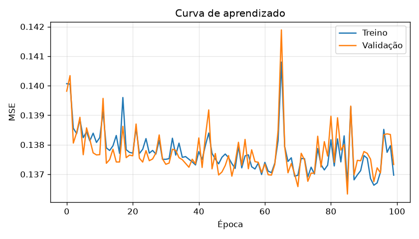

# Previsão de Inadimplência de Cartão de Crédito com Rede Neural MLP

Projeto da disciplina de **Inteligência Artificial (UFRPE)**. Uma rede neural **MLP (Multilayer Perceptron)**, implementada **do zero apenas com NumPy**, estima se um cliente de cartão de crédito **deixará de pagar a próxima fatura**, a partir do perfil financeiro e do histórico de pagamentos.

Ao cadastrar um cliente, a aplicação devolve uma **pontuação de risco** e uma recomendação (aprovar ou negar crédito). Também é possível **importar o banco de dados completo** (30.000 clientes), analisá-los de uma só vez e gerar um relatório de acurácia.

---

## Sumário

1. [Visão geral](#visão-geral)
2. [Estrutura do projeto](#estrutura-do-projeto)
3. [Instalação e uso](#instalação-e-uso)
4. [Base de dados](#base-de-dados)
5. [Entradas e saída da rede](#entradas-e-saída-da-rede)
6. [Arquitetura e aprendizado](#arquitetura-e-aprendizado)
7. [Pré-processamento e treinamento](#pré-processamento-e-treinamento)
8. [Limiar de decisão](#limiar-de-decisão)
9. [Resultados](#resultados)
10. [Validações](#validações)
11. [Experimentos: mais entradas e mais neurônios](#experimentos-mais-entradas-e-mais-neurônios)
12. [Como a aplicação funciona](#como-a-aplicação-funciona)
13. [Limitações](#limitações)
14. [Referência](#referência)

---

## Visão geral

| Item | Especificação |
|---|---|
| Tipo de problema | Classificação binária (vai ou não dar calote) |
| Modelo | MLP com 1 camada oculta, implementada em NumPy |
| Entradas | 4 |
| Camada oculta | 8 neurônios, ativação **ReLU** |
| Saída | 1 neurônio, ativação **sigmoide** (valor entre 0 e 1) |
| Função de erro | **MSE** (Erro Quadrático Médio) |
| Aprendizado | **Backpropagation** + gradiente descendente em mini-batches |
| Dados | 30.000 clientes (UCI Machine Learning Repository) |

---

## Estrutura do projeto

```
credito_mlp/
├── mlp.py                 # A rede neural (forward, backpropagation, treino, salvar/carregar)
├── treinamento.py         # Leitura dos dados, normalização, treino, avaliação e salvamento do modelo
├── app.py                 # Aplicação (menu): cadastro, importação do banco, relatório e exportação
├── avaliar_todos.py       # Avalia o modelo salvo em todos os clientes, separando treino/validação/teste
├── validacoes.py          # Bateria de 16 testes que comprova o funcionamento do projeto
├── modelo_mlp.npz         # Modelo treinado (pesos, normalização e limiar)
├── curva_aprendizado.png  # Gráfico do MSE por época (treino x validação)
├── requirements.txt       # Dependências
└── default_of_credit_card_clients.xls   # Banco de dados (baixar do UCI, ver abaixo)
```

---

## Instalação e uso

**Requisitos:** Python 3.9 ou superior.

```bash
pip install -r requirements.txt
```

Baixe o banco de dados (veja [Base de dados](#base-de-dados)) e coloque o arquivo `default_of_credit_card_clients.xls` na mesma pasta dos scripts.

```bash
python treinamento.py     # treina a rede e gera modelo_mlp.npz e curva_aprendizado.png
python app.py             # abre a aplicação (se o modelo_mlp.npz não existir, treina e salva um novo)
python avaliar_todos.py   # avalia o modelo em todos os 30.000 clientes
                          # (se o modelo_mlp.npz não existir, treina e salva um novo antes)
python validacoes.py      # roda as 16 validações do projeto
```

O repositório já inclui um `modelo_mlp.npz` treinado, então é possível rodar `app.py` direto. Se o arquivo for removido, tanto o `app.py` quanto o `avaliar_todos.py` treinam e salvam um novo automaticamente (é necessário que o `.xls` esteja na pasta). O modelo gerado é sempre o mesmo, pois todas as sementes aleatórias são fixas.

### Menu da aplicação

| Opção | Função |
|---|---|
| 1 | Cadastrar um cliente e analisar o risco |
| 2 | Listar clientes cadastrados (totais de alto e baixo risco e os 20 últimos) |
| 3 | Importar o banco de dados completo (`.xls`, `.xlsx` ou `.csv`) e analisar todos de uma vez |
| 4 | Relatório de acurácia dos clientes que têm resultado real conhecido |
| 5 | Exportar os resultados para `resultados_clientes.csv` |
| 0 | Sair |

---

## Base de dados

**Default of Credit Card Clients**, do UCI Machine Learning Repository, com dados de clientes de cartão de crédito de Taiwan (2005).

- **30.000 clientes**, 23 variáveis explicativas e 1 variável-alvo (`default payment next month`: 1 = não pagou, 0 = pagou).
- **22,1% dos clientes são inadimplentes**: a base é **desbalanceada**. Um modelo que sempre responde "vai pagar" acerta 77,9% sem detectar nenhum calote. Por isso a acurácia sozinha não basta e o projeto também reporta precisão, recall, F1 e AUC.
- Variáveis originais: limite de crédito, sexo, escolaridade, estado civil, idade, situação de pagamento dos últimos 6 meses (`PAY_0`, `PAY_2` a `PAY_6`), valor das faturas (`BILL_AMT1` a `BILL_AMT6`) e valor dos pagamentos (`PAY_AMT1` a `PAY_AMT6`).

Codificação das colunas `PAY_*`:

| Valor | Significado |
|---|---|
| -2 | Não usou o cartão no mês |
| -1 | Pagou a fatura inteira |
| 0 | Pagou apenas o mínimo (crédito rotativo) |
| 1 a 9 | Meses de atraso |

> Os arquivos `clientes.json` e `resultados_clientes.csv` são gerados pela aplicação e contêm os dados dos clientes. Recomenda-se colocá-los no `.gitignore`.

---

## Entradas e saída da rede

### As 4 entradas

A escolha foi feita analisando cada variável isoladamente (AUC e correlação com o calote) e comparando conjuntos de 4 entradas treinando a própria MLP.

| Entrada | Como é calculada | Por que foi escolhida |
|---|---|---|
| `PAY_0` | Situação do pagamento no mês mais recente | Variável original mais forte (AUC isolado ≈ 0,69) |
| `PAY_MAX` | Maior valor entre os 6 meses de situação de pagamento (pior atraso) | Melhor variável de todas (AUC isolado ≈ 0,71); resume as 6 colunas de histórico em uma |
| `LOG_LIMITE` | `log(1 + limite de crédito)` | Representa o perfil financeiro e é pouco correlacionada com o histórico |
| `LOG_PAGTO` | `log(1 + valor pago na última fatura)` | Traz o comportamento de pagamento, que os status de atraso não capturam |

O logaritmo é usado porque valores em dinheiro são muito assimétricos (poucos clientes com valores enormes).

**Variáveis descartadas:** idade, sexo, escolaridade e estado civil têm AUC próximo de 0,50, ou seja, quase não ajudam a prever o calote. Trocar `LOG_PAGTO` pela idade piorou o resultado. Além disso, usar sexo ou estado civil em decisões de crédito levanta questões éticas de discriminação.

### A saída

Um único neurônio com **sigmoide**, que produz um valor entre 0 e 1. Como a rede é treinada com MSE sobre 0 e 1, esse valor se comporta aproximadamente como a **probabilidade de inadimplência**. Medindo nos 30.000 clientes, a taxa real de calote por faixa de saída foi:

| Saída da rede | Clientes | Taxa real de calote |
|---|---|---|
| 0,00 a 0,15 | 13.547 | 8,9% |
| 0,15 a 0,25 | 7.660 | 17,6% |
| 0,25 a 0,35 | 3.581 | 28,7% |
| 0,35 a 0,50 | 1.810 | 40,0% |
| 0,50 a 0,70 | 2.630 | 67,6% |
| 0,70 a 1,00 | 772 | 70,9% |

---

## Arquitetura e aprendizado

```
 4 entradas ──► 8 neurônios ocultos (ReLU) ──► 1 neurônio de saída (sigmoide) ──► risco (0 a 1)
```

**Parâmetros da rede:** `W1` (4×8), `b1` (1×8), `W2` (8×1) e `b2` (1×1), ou seja, 49 parâmetros. A inicialização é aleatória: **He** na camada ReLU (desvio √(2/entradas)) e **Xavier** na saída (desvio √(1/ocultos)).

### Forward (passo para frente)

```
Z1 = X · W1 + b1        A1 = ReLU(Z1) = max(0, Z1)
Z2 = A1 · W2 + b2       ŷ  = sigmoide(Z2) = 1 / (1 + e^(-Z2))
```

### Erro (MSE)

```
MSE = média( (ŷ − y)² )
```

### Backpropagation

Aplicação da regra da cadeia, da saída para a entrada (implementada em `MLP.backward`):

```
1. dMSE/dŷ  = 2 (ŷ − y) / n               derivada do erro
2. dZ2      = dMSE/dŷ · ŷ (1 − ŷ)         passa pela sigmoide
3. dW2      = A1ᵀ · dZ2     db2 = Σ dZ2   gradientes da camada de saída
4. dA1      = dZ2 · W2ᵀ                    propaga o erro para a camada oculta
5. dZ1      = dA1 · ReLU'(Z1)              ReLU' = 1 se Z1 > 0, senão 0
6. dW1      = Xᵀ · dZ1      db1 = Σ dZ1   gradientes da camada oculta
7. peso     = peso − taxa_de_aprendizado · gradiente   (gradiente descendente)
```

A implementação do backpropagation foi comprovada por **verificação numérica de gradiente** (veja [Validações](#validações)).

---

## Pré-processamento e treinamento

| Item | Valor |
|---|---|
| Divisão dos dados | 70% treino (21.000), 15% validação (4.500), 15% teste (4.500), com semente fixa (42) |
| Normalização | Média 0 e desvio 1, calculados **somente no treino** para evitar vazamento de dados |
| Taxa de aprendizado | 0,5 |
| Épocas | 100 |
| Tamanho do lote (mini-batch) | 64, com embaralhamento a cada época |

A normalização é necessária porque as entradas têm escalas muito diferentes (por exemplo, status de atraso de −2 a 9 contra o log do limite). Os valores de média e desvio ficam salvos no `modelo_mlp.npz` e são reaplicados no cadastro.

A curva de aprendizado (`curva_aprendizado.png`) mostra treino e validação praticamente sobrepostos, sem sinal de overfitting.



---

## Limiar de decisão

A rede devolve um valor entre 0 e 1, e é preciso definir a partir de qual valor o cliente é classificado como **alto risco**. O padrão de 0,5 seria muito conservador numa base com apenas 22% de inadimplentes: só 11,8% dos clientes seriam marcados e apenas 37% dos calotes seriam detectados.

Por isso `treinamento.py` testa limiares de 0,05 a 0,94 no conjunto de **validação** e escolhe o que maximiza o **F1**. O resultado foi **0,25**, salvo no modelo. Resultados na validação:

| Limiar | Marcados como alto risco | Acurácia | Precisão | Recall | F1 |
|---|---|---|---|---|---|
| 0,15 | 55,2% | 59,6% | 34,1% | 82,3% | 0,482 |
| 0,20 | 37,1% | 71,6% | 42,5% | 69,1% | 0,526 |
| **0,25** | **30,0%** | **75,7%** | **47,6%** | **62,5%** | **0,540** |
| 0,30 | 19,5% | 79,9% | 57,1% | 48,8% | 0,526 |
| 0,40 | 14,4% | 81,8% | 66,3% | 41,8% | 0,513 |
| 0,50 | 11,8% | 82,4% | 72,1% | 37,3% | 0,491 |

Subir o limiar reduz os alarmes falsos, mas deixa passar mais calotes; descer faz o contrário. A escolha ideal depende de qual erro custa mais para a instituição: conceder crédito a quem não paga ou negar crédito a quem pagaria.

"Alto risco" significa que o cliente pertence a um grupo com taxa de calote **acima da média** (cerca de 1 em 4 contra 1 em 5), e não que ele certamente deixará de pagar. Clientes com pontuação muito próxima do limiar (por exemplo, 25,3% e 24,9%) recebem rótulos opostos apesar de risco praticamente igual.

---

## Resultados

### Conjunto de teste (4.500 clientes que a rede nunca viu)

| Métrica | Limiar 0,25 | Limiar 0,50 |
|---|---|---|
| Acurácia | 76,1% | 82,1% |
| Precisão | 47,9% | 69,6% |
| Recall | 61,8% | 37,0% |
| F1 | 0,539 | 0,483 |
| AUC-ROC | 0,767 | 0,767 |

### Banco completo (30.000 clientes)

| Métrica | Limiar 0,25 | Limiar 0,50 |
|---|---|---|
| Acurácia | 75,8% | 82,0% |
| Precisão | 46,4% | 68,4% |
| Recall | 61,4% | 35,1% |
| F1 | 0,528 | 0,463 |
| AUC-ROC | 0,770 | 0,770 |

Matriz de confusão no banco completo:

| | Limiar 0,25 | Limiar 0,50 |
|---|---|---|
| Calotes detectados (verdadeiros positivos) | 4.077 | 2.326 |
| Alarmes falsos (falsos positivos) | 4.716 | 1.076 |
| Bons pagadores corretos (verdadeiros negativos) | 18.648 | 22.288 |
| Calotes não detectados (falsos negativos) | 2.559 | 4.310 |

### Como interpretar

- **Acurácia e baseline.** O chute "ninguém dá calote" acerta 77,9% (77,4% no conjunto de teste). Com limiar 0,25 a acurácia fica *abaixo* disso porque o modelo prefere acusar risco a deixar passar calote; com 0,50 ela passa do baseline, mas detecta só 35% a 37% dos calotes. Por isso **recall, F1 e AUC** são as métricas mais informativas aqui.
- **Número otimista.** O resultado do "banco completo" inclui os dados usados no treino. O número de generalização é o do conjunto de teste.
- **Teto do problema.** Um AUC em torno de 0,77 a 0,78 é típico para esse banco de dados, mesmo com modelos mais complexos.

---

## Validações

O projeto passou por três tipos de validação: **estatística** (o modelo generaliza?), **numérica** (o código de aprendizado está correto?) e **funcional** (a aplicação se comporta bem?). As validações numéricas e funcionais estão automatizadas em `validacoes.py`.

### 1. Validação estatística do modelo

| Verificação | Como foi feita | Resultado |
|---|---|---|
| Generalização (overfitting) | Acurácia com limiar 0,25 em treino, validação e teste | 75,7%, 75,7% e 76,1%: praticamente iguais, sem overfitting |
| Curva de aprendizado | MSE de treino e de validação por época (`curva_aprendizado.png`) | Curvas sobrepostas |
| Dados nunca vistos | Avaliação em 4.500 clientes separados (15%) usados só no final | AUC 0,767, recall 61,8% |
| Comparação com um chute | Baseline "ninguém dá calote" | 77,4% de acurácia no teste, mas 0% de recall; o modelo detecta 61,8% dos calotes |
| Escolha do limiar | Busca de 0,05 a 0,94 na **validação** (não no teste) | 0,25, que maximiza o F1 |
| Calibração da saída | Taxa real de calote por faixa de saída da rede | Cresce de 8,9% a 70,9%, acompanhando a pontuação (tabela em [A saída](#a-saída)) |
| Escolha das entradas | AUC isolado de cada variável e comparação de conjuntos treinando a MLP | `PAY_0`, `PAY_MAX`, limite e último pagamento; idade, sexo, escolaridade e estado civil ≈ 0,50 |
| Tamanho da rede | Grade de 5 conjuntos de entradas × 5 tamanhos de camada oculta | Mais entradas ou neurônios quase não melhoram (ver [Experimentos](#experimentos-mais-entradas-e-mais-neurônios)) |

### 2. Validações automatizadas (`python validacoes.py`)

Resultado da última execução: **16 de 16 validações passaram** (cerca de 11 segundos).

**A) A rede neural**

| Validação | O que comprova | Resultado |
|---|---|---|
| Gradiente numérico | O backpropagation calcula os mesmos gradientes que a derivada numérica `(f(w+ε) − f(w−ε)) / 2ε` para `W1`, `b1`, `W2` e `b2` | Erro relativo máximo de 1,1 × 10⁻⁹ |
| Saída entre 0 e 1 | A sigmoide mantém a saída válida, inclusive com entradas extremas (escala 50×) | Formato (n, 1), valores finitos entre 0 e 1 |
| Problema XOR | A rede 2-8-1 com ReLU, sigmoide e MSE aprende um problema não linear que um neurônio sozinho não resolve | MSE de 0,261 para 0,0001; 4 de 4 acertos |
| Métricas | Acurácia, precisão, recall, F1, matriz de confusão e AUC conferidos em casos pequenos com resposta conhecida | Corretas |

**B) Os dados**

| Validação | O que comprova | Resultado |
|---|---|---|
| Integridade do banco | 30.000 linhas, IDs únicos, sem valores nulos nas colunas usadas, alvo só com 0 e 1 | 22,1% de inadimplentes; `PAY` de −2 a 8; limite de 10.000 a 1.000.000 |
| Pagamentos | Nenhum valor de pagamento negativo | Válido |
| Lote × individual | As entradas calculadas em lote (importação) são idênticas às do cadastro individual | 5.000 clientes comparados, idênticos |
| Divisão dos dados | 70/15/15 sem nenhum cliente repetido entre treino, validação e teste | 21.000 / 4.500 / 4.500 |
| Sem vazamento | A média e o desvio da normalização salvos no modelo vêm só do treino | Coincidem |

**C) O modelo salvo**

| Validação | O que comprova | Resultado |
|---|---|---|
| Arquitetura | O arquivo tem `W1` 4×8, `W2` 8×1 e limiar entre 0 e 1 | Limiar 0,25 |
| Reprodutibilidade | Retreinar do zero, numa pasta temporária, gera exatamente os mesmos pesos, normalização e limiar | Idêntico |

**D) A aplicação**

| Validação | O que comprova | Resultado |
|---|---|---|
| Entradas do cadastro | Rejeita texto, valores fora da faixa e decimais onde se exige inteiro; aceita vírgula decimal | Aceitos: 2000, 3 e 1,5 |
| Importação completa | Importa os 30.000 clientes e **não duplica** ao importar o mesmo arquivo de novo | 30.000 na 1ª e na 2ª importação |
| Lote × cadastro | A previsão da importação em lote é igual à do cadastro individual | 300 clientes; maior diferença 4,9 × 10⁻⁵ (arredondamento a 4 casas) |
| Exportação | O CSV tem cabeçalho e uma linha por cliente | 30.001 linhas |
| Arquivos ausentes | Sem modelo e sem banco, o app avisa em vez de quebrar | Mensagem clara |

Os testes que gravam arquivos usam pastas temporárias, então **não alteram** o seu `modelo_mlp.npz` nem o seu `clientes.json`.

### 3. Validações embutidas na aplicação

| Situação | O que o app faz |
|---|---|
| Limite do cartão menor que 1 ou texto no lugar de número | Pede o valor novamente |
| Situação de pagamento fora de −2 a 9 ou não inteira | Pede o valor novamente |
| Valor pago negativo | Pede o valor novamente |
| Importação de arquivo inexistente ou ilegível | Mostra o motivo e volta ao menu |
| Colunas obrigatórias ausentes no arquivo importado | Informa quais colunas faltam |
| Importar o mesmo banco duas vezes | Ignora clientes com `ID` já cadastrado |
| Modelo ausente | Treina e salva um novo automaticamente |
| Modelo e banco ausentes | Avisa que o `.xls` precisa estar na pasta |
| Relatório sem clientes com resultado real | Orienta a importar o banco completo |

---

## Experimentos: mais entradas e mais neurônios

Variando o número de entradas (4, 6, 8, 10 e as 23 variáveis) e de neurônios ocultos (4, 8, 16, 32 e 64), todos medidos no conjunto de teste:

| Entradas | AUC (8 neurônios) | Acurácia com limiar 0,5 |
|---|---|---|
| 4 (atual) | 0,768 | 82,0% |
| 6 | 0,774 | 81,9% |
| 8 | 0,776 | 81,8% |
| 10 | 0,778 | 81,9% |
| 23 (todas) | 0,779 | 81,8% |

- **Mais entradas ajudam pouco.** O AUC sobe cerca de 0,01 e a acurácia não muda.
- **Mais neurônios não ajudam.** Com 4 a 64 neurônios, o AUC fica entre 0,766 e 0,779 e a acurácia com limiar 0,5 em torno de 82%.
- **Conclusão:** a configuração pedida (4 entradas e 8 neurônios) já está perto do teto desses dados. O que mais influencia a acurácia é o **limiar de decisão**, que troca acurácia por recall.
- **Ressalva:** cada configuração foi treinada uma única vez, com uma só divisão dos dados, então diferenças de 0,005 a 0,01 no AUC podem ser ruído.

Mudanças fora da especificação, como entropia cruzada no lugar do MSE, pesos maiores para a classe de calotes, otimizador Adam ou parada antecipada, não foram testadas.

---

## Como a aplicação funciona

### Cadastro individual (opção 1)

O usuário informa nome, limite do cartão, a situação de pagamento dos 6 últimos meses e o valor pago na última fatura. A aplicação calcula `PAY_0` e `PAY_MAX` sozinha, aplica o logaritmo e a normalização do treino, passa os valores pela rede e mostra:

- a **pontuação de risco** (saída da rede);
- a **previsão**: alto risco (pontuação ≥ limiar) ou baixo risco;
- uma **sugestão**: crédito negado, com limite reduzido ou em análise manual, ou crédito aprovado.

### Importação do banco completo (opção 3)

- Lê `.xls`, `.xlsx` ou `.csv` e aceita variações do dataset (`PAY_1` no lugar de `PAY_0`, `default.payment.next.month`).
- Faz a previsão dos 30.000 clientes **de uma só vez**, em operações de matriz, em poucos segundos.
- Ignora clientes cujo `ID` já foi importado, evitando duplicatas.
- Ao final, mostra o relatório de acurácia.

### Relatório e exportação (opções 4 e 5)

O relatório mostra acurácia, precisão, recall, F1, matriz de confusão e AUC com limiares 0,25 e 0,50. A exportação gera `resultados_clientes.csv` (separador `;`) com as colunas:

| Coluna | Conteúdo |
|---|---|
| `id` | Identificador do cliente (vazio nos cadastros manuais) |
| `nome` | Nome ou "Cliente ID" |
| `limite` | Limite do cartão |
| `ultimo_pagamento` | Valor pago na última fatura |
| `risco` | Saída da rede (0 a 1) |
| `previsao` | 1 = alto risco, 0 = baixo risco |
| `real` | Resultado real, quando conhecido |
| `acertou` | 1 se a previsão coincide com o real |

---

## Limitações

- **Uma única divisão dos dados.** Os resultados vêm de uma divisão treino/validação/teste com semente fixa. Não foi feita validação cruzada (k-fold), então não há estimativa da variação do resultado entre divisões diferentes.
- **Entradas fora da faixa vista.** O limite no banco vai de 10.000 a 1.000.000 NT$ (mediana 140.000). Valores muito diferentes, como um limite de 1.000, fazem a rede extrapolar e o resultado perde confiabilidade. O app não bloqueia esses valores.
- **Precisão moderada.** Com limiar 0,25, cerca de metade dos clientes marcados como alto risco paga normalmente (precisão de 47,9% no teste).
- **Dados antigos e de uma região.** O banco é de Taiwan, de 2005; o modelo não deve ser usado para decisões reais de crédito.
- **Ética.** O modelo não usa sexo, idade, escolaridade nem estado civil, o que reduz o risco de discriminação, mas qualquer uso real exigiria uma análise de viés e conformidade legal.
- **Projeto didático.** O objetivo é estudar o funcionamento de uma MLP e do backpropagation, por isso não há bibliotecas de aprendizado de máquina (scikit-learn, TensorFlow etc.) no treino.

---

## Referência

Yeh, I. C., & Lien, C. H. (2009). *The comparisons of data mining techniques for the predictive accuracy of probability of default of credit card clients.* Expert Systems with Applications, 36(2), 2473-2480.

Base de dados: UCI Machine Learning Repository, *Default of Credit Card Clients*. Consulte a página do dataset para as condições de uso e licença antes de redistribuir o arquivo.
